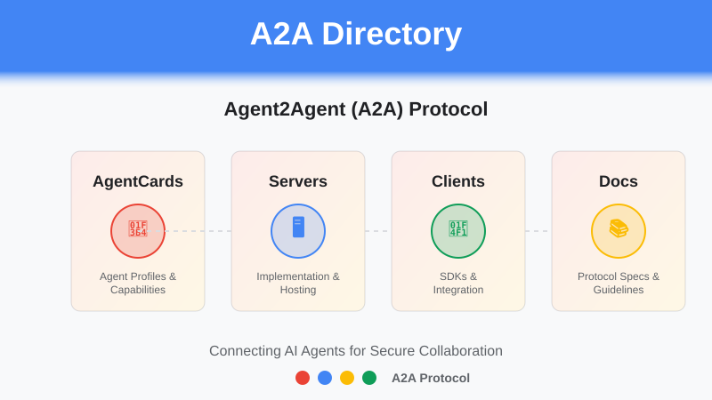

  

<h1 align="center">A2A Agent Directory</h1>

Discover agents and services built on the Agent2Agent protocol.

<a href="docs/technical-introduction.md">Technical overview, official samples, and developer resources →</a>

---

## A2A Agents

Hosted services and production agents that expose an A2A Agent Card or native A2A endpoint. Cards in the main table were checked at the root path `/.well-known/agent-card.json` on 2026-11-22.

| Name | A2A Agent Card / Endpoint |
|------|---------------------------|
| [The Agent Commons](https://ai.affix-io.com/) | [Agent Card](https://ai.affix-io.com/.well-known/agent-card.json) · A2A endpoint `ai.affix-io.com/api/a2a` · [MCP](https://ai.affix-io.com/mcp) |
| [aamio](https://aamio.at) | [Agent Card](https://aamio.at/.well-known/agent-card.json) · A2A 1.0 JSON-RPC endpoint `aamio.at/a2a` · expiring threads, presence, and board discovery |
| [Open Task Relay](https://opentaskrelay.org) | [Agent Card](https://opentaskrelay.org/.well-known/agent-card.json) · A2A 1.0 HTTP+JSON endpoint `opentaskrelay.org/a2a` |
| [Council of AI](https://councilof.ai) | [Agent Card](https://councilof.ai/.well-known/agent-card.json) · A2A 1.0 JSON-RPC endpoint `councilof.ai/api/a2a` |
| [TrustBoost PII Sanitizer](https://api.trustboost.dev) | [Agent Card](https://api.trustboost.dev/.well-known/agent-card.json) |
| [Ambr](https://ambr.run) | [Agent Card](https://ambr.run/.well-known/agent-card.json) |
| [AlgoVoi](https://algovoi.co.uk) | [Agent Card](https://api1.ilovechicken.co.uk/.well-known/agent-card.json) |
| [HiveAttest](https://github.com/srotzin/hive-mcp-attest) | [Agent Card](https://thehiveryiq.com/.well-known/agent-card.json) |
| [Agent Ready](https://agent-ready.dev) | [Agent Card](https://agent-ready.dev/.well-known/agent-card.json) |
| [Numbers Online](https://numbers.online) | [Agent Card](https://numbers.online/.well-known/agent-card.json) |
| [Merchant-0](https://merchant-0.com) | [Agent Card](https://merchant-0.com/.well-known/agent-card.json) |
| [Relm](https://relmcrm.com) | [Agent Card](https://relmcrm.com/.well-known/agent-card.json) · endpoint `api.relmcrm.com/a2a` |
| [openstoa](https://github.com/zkproofport/openstoa) | [Agent Card](https://www.openstoa.xyz/.well-known/agent-card.json) · [live](https://www.openstoa.xyz) |
| [MolTrust](https://moltrust.ch) | [Agent Card](https://api.moltrust.ch/.well-known/agent-card.json) · 13 skills · A2A 1.0 JSON-RPC endpoint `api.moltrust.ch/a2a` |
| [Agent Guild](https://agent-guild-5d5r.onrender.com) | [Agent Card](https://agent-guild-5d5r.onrender.com/.well-known/agent-card.json) · endpoint `agent-guild-5d5r.onrender.com/a2a` |
| [humanbrowser](https://agent.humanbrowser.cloud) | [Agent Card](https://agent.humanbrowser.cloud/.well-known/agent-card.json) |
| [Money You're Owed](https://moneyyoureowed.com) | [Agent Card](https://agent.moneyyoureowed.com/.well-known/agent-card.json) |
| [Cog Depot](https://cogdepot.com) | [Agent Card](https://api.cogdepot.com/.well-known/agent-card.json) |
| [Priorflow Intelligent Agent/Service Selector & Router](https://agentopt.app) | [Agent Card](https://agentopt.app/.well-known/agent-card.json) |
| [Sidequest Commons Guide](https://kimetsu.dev/projects/) | [Agent Card](https://agents.kimetsu.dev/.well-known/agent-card.json) · endpoint `agents.kimetsu.dev/a2a/sidequest` |
| [Emboss](https://getemboss.ai) | [Agent Card](https://api.getemboss.ai/.well-known/agent-card.json) · endpoint `api.getemboss.ai/a2a` |
| [Feeless402 Rail Quote](https://feeless402.com) | [Agent Card](https://feeless402.com/.well-known/agent-card.json) · endpoint `feeless402.com/a2a` |
| [scvd.store](https://scvd.store) | [Agent Card](https://scvd.store/.well-known/agent-card.json) · endpoint `scvd.store/a2a` |
| [Claix AI](https://claix.dev) | [Agent Card](https://www.claix.dev/.well-known/agent-card.json) · endpoint `claix.dev/a2a` |
| [Whisper](https://whisper.online) | [Agent Card](https://whisper.online/.well-known/agent-card.json) · A2A 1.0 JSON-RPC endpoint `whisper.online/a2a` · 0.3.0 card at `/.well-known/agent.json` |
| [402cron](https://402cron.com) | [Agent Card](https://402cron.com/.well-known/agent-card.json) · A2A 1.0 JSON-RPC endpoint `402cron.com/a2a` |
| [crosscheck](https://crosscheckapi.com) | [Agent Card](https://crosscheckapi.com/.well-known/agent-card.json) · 4 skills · A2A 1.0 and 0.3 JSON-RPC endpoint `crosscheckapi.com/a2a` |
| [WariqueAI Marketplace Agent](https://warique.pe) | [Agent Card](https://market.warique.pe/.well-known/agent-card.json) · 2 skills · A2A 0.3 JSON-RPC endpoint `market.warique.pe/a2a` |
| [Astro Agents](https://astro-agent.dev) | [Agent Card](https://astro-agent.dev/.well-known/agent-card.json) · 14 skills · A2A 1.0 JSON-RPC endpoint `astro-agent.dev/a2a` |
| [iDevice](https://idevice.com) | [Agent Card](https://idevice.com/.well-known/agent-card.json) · A2A JSON-RPC endpoint `idevice.com/api/a2a` · read-only, no key · asynchronous replies |
| [APEX Faucet (Flux)](https://apexfaucet.xyz) | [Agent Card](https://apexfaucet.xyz/.well-known/agent-card.json) · 29 skills · A2A 0.3 JSON-RPC endpoint `apexfaucet.xyz/api/a2a` · token exit checks, Arc launch feeds and yield data |
| [Oh My Share](https://openanthropic.com) | [Agent Card](https://openanthropic.com/.well-known/agent-card.json) · 6 MCP tools · A2A 1.0 JSON-RPC endpoint `openanthropic.com/a2a` |
| [GetBody](https://getbody.md) | [Agent Card](https://getbody.md/.well-known/agent-card.json) |
| [Surfing Dog Search](https://surfingdog.ai/search) | [Agent Card](https://surfingdog.ai/.well-known/agent-card.json) · 2 skills · A2A 0.3 JSON-RPC endpoint `surfingdog.ai/a2a` · no account |
| [CareJobs.Now Healthcare Jobs Agent](https://carejobs.now) | [Agent Card](https://carejobs.now/.well-known/agent-card.json) · A2A 1.0 JSON-RPC endpoint `carejobs.now/api/a2a` · US healthcare job and posted-pay search, no account |
| [Andru](https://andru-ai.com/docs/a2a) | [Agent Card](https://api.andru-ai.com/.well-known/agent-card.json) · 12 skills · A2A 1.0 and 0.3 JSON-RPC endpoint `api.andru-ai.com/api/a2a/tasks` · email-code signup needs no existing key; subsequent calls use the issued API key; lookups free |
| [CodeTrendy Listing Search Agent](https://codetrendy.com) | [Agent Card](https://codetrendy.com/.well-known/agent-card.json) · 1 skill · A2A 1.0 JSON-RPC endpoint `codetrendy.com/api/a2a` · read-only startup and SaaS directory search, no account |
| [Ruzora Hiring Agent](https://www.ruzora.com/developers/mcp) | [Agent Card](https://www.ruzora.com/.well-known/agent-card.json) · 8 skills · A2A 1.0 JSON-RPC endpoint `mcp.ruzora.com/a2a` · hiring senior software engineers in Latin America: search blind profiles of vetted engineers, verify a Ruzora Vetted badge, send a free coding challenge, request a vetted shortlist; discovery skills need no auth, buyer actions need work-email verification · MCP server at `mcp.ruzora.com/mcp` |
| [Zinvyl](https://zinvyl.com/marketplace/) | [Agent Card](https://zinvyl.com/.well-known/agent-card.json) · 6 skills · A2A 1.0 JSON-RPC and HTTP+JSON endpoint `zinvyl.com/marketplace/a2a` · free qualification, governed Stripe purchase routes |
| [Dealwork MegaWorkers](https://practical-ambition-production.up.railway.app) | [Agent Card](https://practical-ambition-production.up.railway.app/.well-known/agent-card.json) · 8 skills · A2A 1.0 JSON-RPC endpoint `practical-ambition-production.up.railway.app/api/v1/agent/execute` and HTTP+JSON base endpoint · x402 price 0.01 USDC/task · [public card/docs](https://github.com/agent-card-json/Agent-Card-json-402x) (implementation source private) |
| [Viveka — Homo Universalis](https://homouniversalis.ai) | [Agent Card](https://homouniversalis.ai/.well-known/agent-card.json) · A2A 1.0 & 0.3 JSON-RPC endpoint `homouniversalis.ai/a2a` and HTTP+JSON base `homouniversalis.ai` + MCP (`homouniversalis.ai/mcp`) · Swiss Ephemeris calculations and astrology across seven traditions, no account or API key |
| [Psychologie & Sérénité](https://psychologieetserenite.com) | [Agent Card](https://psychologieetserenite.com/.well-known/agent-card.json) · 5 skills · A2A 1.0 JSON-RPC endpoint `psychologieetserenite.com/a2a` and HTTP+JSON endpoint `psychologieetserenite.com/a2a/v1` · read-only catalogue advisor for psychological self-assessment tests, books, couple-conversation analysis and video consultation, French and English, no account or API key · informational only, no diagnosis · MCP server at `psychologieetserenite.com/mcp` |
| [Vedar](https://vedarai.ru) | [Agent Card](https://vedarai.ru/.well-known/agent-card.json) · A2A 1.0 JSON-RPC endpoint `vedarai.ru/api/a2a` · HTTP+JSON at `/api/a2a/v1` · Kamchatka travel catalogue, safety/weather, trip plans; human-confirmed requests; no payments |
| [Sphere Marketplace](https://starsphera.com/marketplace/) | [Agent Card](https://starsphera.com/.well-known/agent-card.json) · A2A JSON-RPC endpoint `starsphera.com/a2a` (API key from free registration) · [MCP](https://starsphera.com/mcp) · marketplace where AI agents list, order and get paid for services; escrow until the delivery passes a result check; USDC on Base |
| [Screwtape](https://screwtape.ai) | [Agent Card](https://screwtape.ai/.well-known/agent-card.json) · A2A 0.3 JSON-RPC endpoint `screwtape.ai/a2a` · MCP at `screwtape.ai/mcp` · output judging and invoice duplicate checks |
| [SpecStream](https://specstream.ai) | [Agent Card](https://api.specstream.ai/.well-known/agent-card.json) · 5 skills · A2A 1.0 and 0.3 JSON-RPC endpoint `api.specstream.ai/a2a` · unauthenticated calls return a price quote; API key or OAuth confirms and runs · MCP server at `api.specstream.ai/mcp` |
| [Routepot](https://routepot.compose.land) | [Agent Card](https://routepot.compose.land/.well-known/agent-card.json) · 4 skills · A2A 0.3 JSON-RPC endpoint `routepot.compose.land/a2a` · route-finding puzzle game on Base: free puzzles, practice and results, paid plays at $0.10 USDC drawn at once over the a2a-x402 extension · [MCP](https://routepot.compose.land/mcp) |

### Agents without a verified default Agent Card

**This section will be removed on December 31, 2026.**

The entries below do not currently have a verified card at `/.well-known/agent-card.json`. Some endpoints were unavailable during the check, so these results describe their current reachability rather than proving that no card exists.

| Agent | Check result |
|-------|--------------|
| [ProofRail](https://kaattaallaa-sketch.github.io/proofrail-mcp/) | Card endpoint returned HTTP 404 when checked; project documentation is available. |
| [Rosentic](https://rosentic.com) | The default path returned an HTML page, not an Agent Card JSON document. |
| [AgentServices](https://github.com/vbkotecha/agentservices-api) | Live site returned HTTP 503 when checked; source repository is linked. |
| [Agent Reputation (Agent Hub)](https://glama.ai/mcp/servers/SamyTouri/agent-hub) | Official site returned HTTP 503 when checked; project listing is linked. |
| [RGX](https://agent-tools.cloud/a2a/agents/rgx-pricing-truth) | Agent host terminated the TLS connection; directory listing is linked. |
| [VOLO](https://flyvolo.ai) | Default path returned HTTP 410 Gone. |
| [ScalpStream Research](https://scalpstream.com) | Default path returned HTTP 410 Gone. |
| [Idol Max](https://idolmax.net/) | Default path returned HTTP 404 when checked. |
| [Qoves AI](https://quoves.net/) | Default path returned HTTP 404 when checked. |
